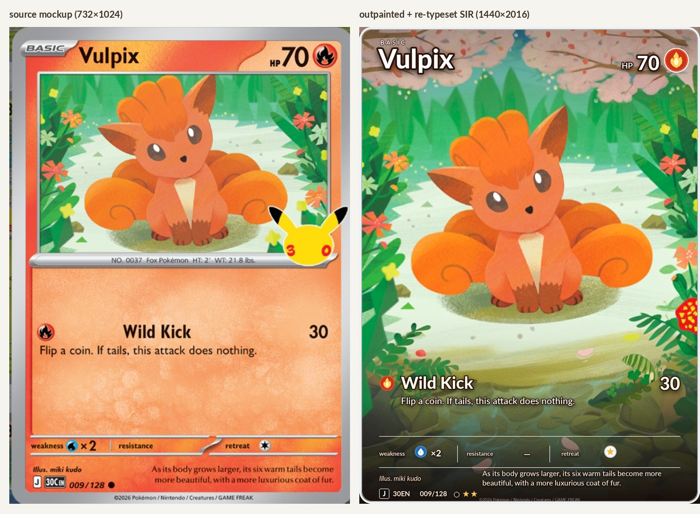
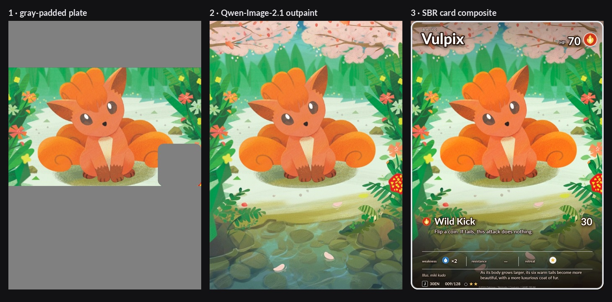

# Vulpix — Illustration Rare outpainting lab

Fan-art pipeline that takes a 732×1024 30th-anniversary Vulpix window card and
rebuilds it as a full-bleed, Special Illustration Rare–style card. The original
window art stays pixel-faithful; the canopy, foreground, atmosphere, typography
and card chrome are rebuilt around it.



## Final cards

Five 1440×2016 cards. **Blossom Stream** is the flagship: cherry canopy, stream
foreground, petals on the water and the original plate kept intact.


| candidate | card | full-bleed art |
|---|---|---|
| Blossom Stream ★ | [1440×2016](final/cards/vulpix_blossom_stream.png) | [art](final/art/vulpix_blossom_stream.jpg) |
| Spring Stream | [1440×2016](final/cards/vulpix_spring_stream.png) | [art](final/art/vulpix_spring_stream.jpg) |
| Cherry Blossom | [1440×2016](final/cards/vulpix_cherry_blossom.png) | [art](final/art/vulpix_cherry_blossom.jpg) |
| Spring Grove | [1440×2016](final/cards/vulpix_spring_grove.png) | [art](final/art/vulpix_spring_grove.jpg) |
| Bluebell Wood | [1440×2016](final/cards/vulpix_bluebell.png) | [art](final/art/vulpix_bluebell.jpg) |

## Pipeline



1. **Plate extraction.** Measure the window interior
   (`x 68..682, y 103..482`; 614×379 px). Cut the 30th-anniversary Pikachu decal
   out with a gray corner mask, margin included.
2. **Gray canvas.** Scale the plate to card width on a 1440×2016 `#808080`
   canvas; 350 px of canopy above, the rest is foreground. The output canvas is
   a multiple of 32 and matches the card ratio.
3. **Outpaint.** Qwen-Image-2.1 INT8 convrot + the
   [ausboss Qwen-Image-2.1 Outpaint LoRA v2](https://huggingface.co/ausboss/Qwen-Image-2.1-Outpaint-LoRA).
   25 steps, CFG 1, `euler`/`simple`, denoise 1.0, native 1440×2016. Two RTX
   4090s run separate ComfyUI workers for fast prompt/seed sweeps.
4. **Keep the raw outpaint.** The LoRA keeps the plate pixel-registered; the fox
   differs from the source by **≈0.83–0.87/255 MAE** across the finalists. A
   20 px paste-back of the full window was worse: it reintroduces the card
   window's inner rim as a hard horizontal seam. Subject restoration is only
   worth it if fidelity drifts; here it did not.
5. **Rebuild the card.** Full-bleed art under a rounded silver border, 5.5%
   contrast and 3.5% saturation lift, gentle radial vignette, Lato typography,
   hand-drawn vector fire/water/colorless energy symbols, SIR footer, two-star
   rarity mark, 1440×2016 plus 732×1024 previews.

## Why this stack

- Qwen-Image-2.1 is a native-2K, reference-conditioned editor; the INT8 convrot
  checkpoint fits a single 24 GB 4090 and preserves the reference strongly.
- The dedicated outpaint LoRA is trained to keep the known picture exactly where
  it is while filling flat gray, which is the right primitive for a card window
  that must not move.
- FLUX.1 Fill (fp8) was available locally and is excellent at masked fills, but
  it does not ship the same pixel-registration behaviour; Qwen + the outpaint
  LoRA was the better fit for preserving a specific character plate.
- The whole pipeline is API-only ComfyUI (`/prompt`, `/view`); no UI needed.
  `scripts/batch_outpaint.py` ran the sweeps.

## What the sweep found

- **Mask the whole decal.** Leaving the sticker's black ear tip outside the gray
  region made the model complete a second Pikachu. Mask the decal plus margin.
- **Describe the whole scene.** Prompting only the missing strip produced generic
  hedge wallpaper; describing the full card scene gave coherent depth and light.
- **Paste-back is a trap.** A 20 px feather of the whole original plate put the
  window's dark inner rim back as a visible line. The raw outpaint blends better.
- **Low-denoise harmonization barely moves style.** A 0.28 Qwen img2img pass with
  the plate as `<image2>` changed just ~2/255 MAE and added toes; it did not fix
  flat foliage and was rejected.
- **Corner repaint was worse than the "artifact".** The red/yellow cluster at the
  right edge is the model's stylized flower, consistent with the red flowers in
  the source. A mask repaint produced a green wash with a visible patch; rejected.
- Golden-hour stream looked good in the sky but turned the water muddy brown;
  it is not in the final five.

## Reproduce

```bash
uv venv .venv --python 3.12
VIRTUAL_ENV=$PWD/.venv uv pip install pillow numpy

# ComfyUI + torch in a separate env (see ComfyUI_app/requirements.txt)
uv venv comfy-venv --python 3.12
VIRTUAL_ENV=$PWD/comfy-venv uv pip install -r ~/Git/ComfyUI_app/requirements.txt

# weights: Comfy-Org/Qwen-Image-2.1 int8 convrot diffusion model,
# qwen3vl_8b_int8_convrot text encoder, qwen_image_2.1_vae_bf16,
# and loras/outpaint-v2.safetensors

python scripts/make_inputs.py
python scripts/batch_outpaint.py --dest out/raw
python scripts/compose_card.py out/raw/<candidate>.png final/cards/<name>.png
```

ComfyUI 0.43.0, PyTorch 2.15.0+cu132. The `work/` and `out/` trees are scratch
and git-ignored; only `final/` is published. Exact prompts and seeds for every
candidate are in `scripts/jobs.py`, `jobs2.py`, `jobs3.py`; sidecar JSONs are
written next to the raw renders.

## Layout

```
assets/source-card.png      source mockup
assets/fonts/               Lato (OFL)
scripts/                    canvas prep, ComfyUI client, outpainting, compositor
scripts/jobs*.py             prompt + seed sweep
final/cards/                1440×2016 finished cards
final/previews/             732×1024 previews
final/art/                  full-bleed art plates (no card chrome)
```

## License / disclaimer

Code is MIT (`LICENSE`). This is unofficial fan art. Pokémon and Vulpix are
© Nintendo / Creatures Inc. / GAME FREAK inc. Not affiliated with or endorsed by
The Pokémon Company; do not sell the output. Qwen-Image-2.1 weights are under the
Qwen Research License; the outpaint LoRA follows its own model card. Lato is
under the SIL Open Font License.
