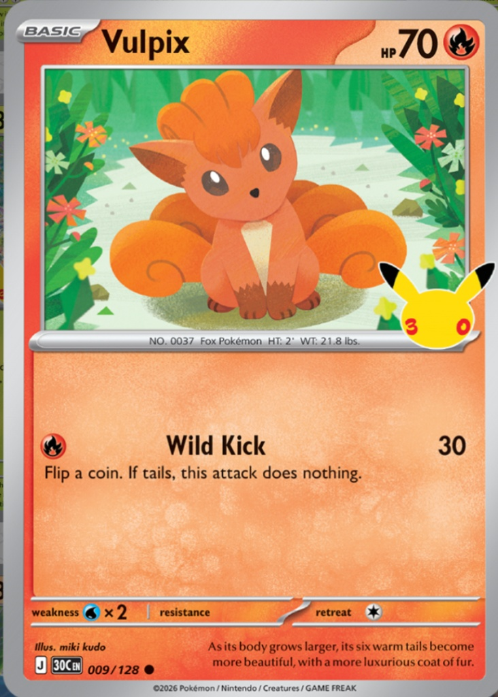

# Vulpix — Illustration Rare outpainting lab

Fan-art pipeline that takes the 732×1024 30th-anniversary Vulpix card mockup
(`assets/source-card.png`) and rebuilds it as a full-bleed, Special Illustration
Rare–style card: the art window is out-painted to the whole card, then the card
chrome is re-typeset over the finished illustration.



## Method

1. **Plate extraction.** The art window interior is measured at
   `x 68..682, y 103..482` (614×379 px). The 30th-anniversary Pikachu sticker
   overlaps the bottom-right corner, so that corner is cut to flat gray.
2. **Canvas.** The plate is scaled to card width and placed on a 1440×2016
   flat-gray canvas (`#808080`), leaving 350 px of canopy above and ~780 px of
   foreground below.
3. **Outpainting.** Qwen-Image-2.1 (Comfy-Org INT8 convrot weights) with the
   [ausboss Qwen-Image-2.1 Outpaint LoRA v2](https://huggingface.co/ausboss/Qwen-Image-2.1-Outpaint-LoRA),
   25 steps, CFG 1, `euler`/`simple`, at the native 1440×2016 canvas. Two RTX
   4090s run separate ComfyUI workers so prompt/seed sweeps finish quickly.
4. **No paste-back.** The LoRA keeps the reference pixel-registered. In the
   chosen render the character region differs from the source by **MAE 1.0/255**,
   so the raw model output is kept. A naive paste-back of the whole window
   re-introduces the window's dark inner rim as a hard seam and is rejected.
5. **Card rebuild.** Full-bleed art, rounded silver border, Lato typography
   (close to the TCG's humanist face), vector-drawn fire/water/colorless energy
   symbols, bottom readability gradient, SIR footer (weakness / resistance /
   retreat / artist / set code / flavour / copyright).

## Results

| candidate | scene | card |
|---|---|---|
| A — spring grove |  |  |

The sweep covers spring grove, golden hour, cherry blossom, misty dawn,
forest-edge sky, twilight fireflies, and a low-angle foreground treatment. The
raw 1440×2016 plates are in `out/raw/` and `out/raw2/`; composed cards are in
`out/cards/`.

## Reproduce

```bash
uv venv comfy-venv --python 3.12
VIRTUAL_ENV=$PWD/comfy-venv uv pip install -r ~/Git/ComfyUI_app/requirements.txt

# weights (official Comfy-Org Qwen-Image-2.1 layout) + both LoRAs
# diffusion_models/qwen_image_2.1_int8_convrot.safetensors
# text_encoders/qwen3vl_8b_int8_convrot.safetensors
# vae/qwen_image_2.1_vae_bf16.safetensors
# loras/outpaint-v2.safetensors

python scripts/make_inputs.py
python scripts/batch_outpaint.py --dest out/raw
python scripts/compose_card.py out/raw/<candidate>.png out/cards/<candidate>_card.png
```

ComfyUI 0.43.0, PyTorch 2.15.0+cu132, `--use-ck-attention` optional. The
pipeline is API-only; no UI is required.

## Findings

- The outfiller is only as good as the mask: leaving the sticker's black ear tip
  outside the gray region made the model complete a second Pikachu. Mask the
  entire decal plus a margin.
- At 1440×2016 the LoRA stays pixel-faithful to the subject (MAE ~1/255) while
  freely inventing canopy and foreground.
- Feathering the original plate back in at 20 px is worse than trusting the
  outpaint: the card window's own vignette/rim becomes a visible horizontal
  line. Restore only the subject if fidelity is in doubt, never the whole plate.
- Prompting the *whole* scene (not just the missing strip) gives a much more
  coherent extension; the scene description doubles as style guidance.

## License / disclaimer

Code is MIT. This is unofficial fan art; Pokémon and Vulpix are © Nintendo /
Creatures Inc. / GAME FREAK inc. Not affiliated with or endorsed by The Pokémon
Company. Do not sell the output. Model weights follow the Qwen Research License;
the outpaint LoRA follows its own model card.
