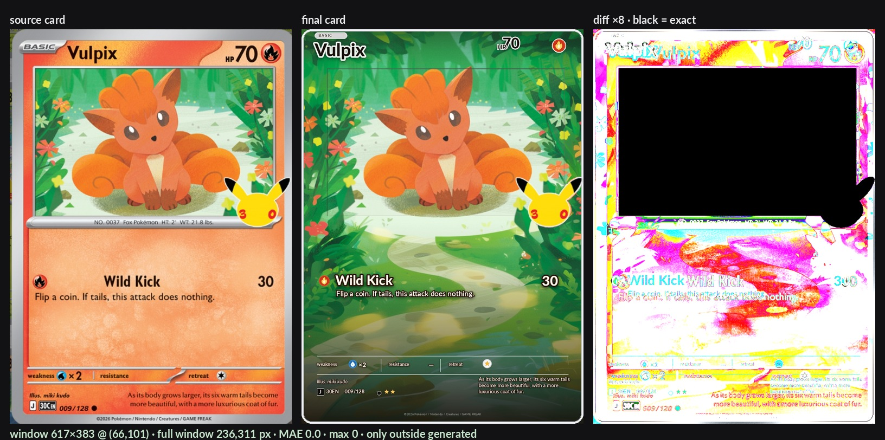
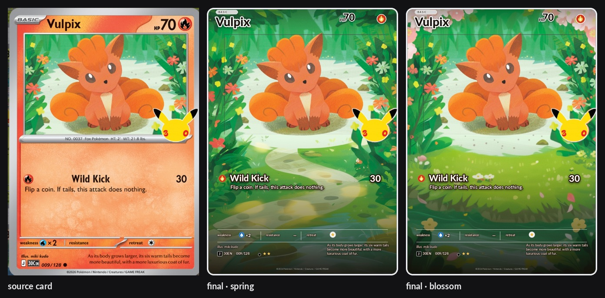

# Vulpix — exact-window outpainting

The source card’s Pokémon art window is **617×383 px at (66,101)** in the
732×1024 card. In the final cards it is copied **1:1 at exactly those
coordinates**. The fox, the background, the sticker and the window’s aspect are
unchanged. **Only the card area outside the window is out-painted.**




## Final cards

| card | art only |
|---|---|
| [Exact Window · Spring](final/cards/vulpix_exact_spring.png) | [art](final/art/vulpix_exact_spring.jpg) |
| [Exact Window · Blossom](final/cards/vulpix_exact_blossom.png) | [art](final/art/vulpix_exact_blossom.jpg) |



## Verification

- Window rect in both source and final: **x 66..683, y 101..484**, size
  **617×383**, aspect **1.611**. No scale, shift, stretch, or crop.
- The **entire 617×383 window (236,311 px)** is pixel-exact: **MAE 0.0**,
  max **0**. No crop, feather, scale, or shift. The fox, background and window
  rim are the source pixels.
- The 30th-anniversary sticker is preserved as a decal at its source position.
- No text, gradient, grade, vignette or border is drawn over the window: the top
  gradient stops at y=94, the bottom starts at y=502, and a protect mask keeps
  the window out of the global grade.
- The window’s thin inner rim is the source image’s own edge, not a generated
  frame. The silver frame/panel outside the art image are out-painted.

## Pipeline


1. **Exact-content canvas.** 736×1024 gray canvas; paste the source art window
   `crop(66,101,683,484)` at `(66,101)`, plus the source sticker mask. Everything
   outside that union is flat gray. No scaling.
2. **Outpaint only the outside.** Qwen-Image-2.1 INT8 convrot + the
   [ausboss outpaint LoRA v2](https://huggingface.co/ausboss/Qwen-Image-2.1-Outpaint-LoRA);
   25 steps, CFG 1, `euler`/`simple`. Two prompts/seeds: spring path/stream and
   cherry-blossom meadow.
3. **Exact composite.** Paste the original 617×383 content and sticker back,
   hard-edged, at their exact source coordinates. The full window is
   pixel-identical; only the outside is generated.
4. **Card chrome outside the window.** Lato typography, vector energy symbols,
   SIR footer, transparent rounded card. The grade/vignette/text gradients are
   confined outside the window.

## Why earlier attempts were wrong

- **v1:** raw outpaint re-rendered the plate — the model output differed from
  the source window by MAE **4.64/255**, max 255, 5.3% of pixels >20. The
  character was altered. Rejected.
- **v2:** the fox was preserved but the window was scaled to card width and its
  background replaced by a generated scene. Wrong size/position/aspect and wrong
  content. Rejected.
- **v3 (this repo):** exact window at exact source geometry; out-paint only the
  outside.

## Reproduce

```bash
# exact-content canvas + sticker mask (SAM ViT-B checkpoint in work/)
python scripts/segment_sticker.py
python scripts/make_content_canvas.py

# out-paint only the gray outside
python scripts/outpaint.py --input work/content_canvas_gray.png \
  --prompt "<scene prompt>" --seed 606 --steps 25 --prefix content_a \
  --out out/win_raw/content_a_606.png

# exact-content card
python scripts/compose_window_card.py out/win_raw/content_a_606.png \
  final/cards/vulpix_exact_spring.png
```

ComfyUI 0.43.0, PyTorch 2.15.0+cu132. Weights: Comfy-Org Qwen-Image-2.1 INT8
convrot diffusion model, `qwen3vl_8b_int8_convrot` text encoder,
`qwen_image_2.1_vae_bf16`, `outpaint-v2.safetensors`. Prompts used are recorded
in the run history; the two published scenes are spring path/stream (seed 606)
and cherry-blossom meadow (seed 707).

## Layout

```
assets/source-card.png        732x1024 source
scripts/make_content_canvas.py exact 617x383 window + sticker on gray
scripts/segment_sticker.py    SAM sticker mask
scripts/compose_window_card.py exact-window card chrome
final/cards/                  final 732x1024 cards
final/art/                    full-bleed art with exact window
final/verification/           source-vs-final + diff proof
```

## License / disclaimer

Code MIT. Unofficial fan art; Pokémon and Vulpix are © Nintendo / Creatures
Inc. / GAME FREAK inc. Not affiliated with or endorsed by The Pokémon Company;
do not sell the output. Qwen-Image-2.1 weights follow the Qwen Research License;
the outpaint LoRA follows its model card. Lato is OFL.
